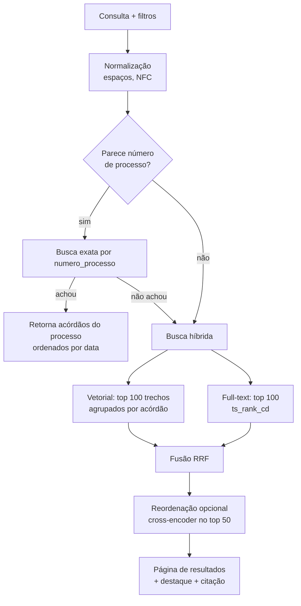

# BuscaJus — Arquitetura do MVP

> Status: **rascunho para revisão**. Este documento formaliza as decisões já tomadas para o MVP. Itens marcados com **[validar]** dependem de confirmação na documentação oficial e viram tarefas de *spike* no [BACKLOG.md](BACKLOG.md).
>
> **Revisão 1 (22/10/2026)**: citação com data de julgamento extraída do cabeçalho do DJEN; Swagger do DJEN validado; ingestão do DJEN passa a usar o **caderno diário** (ZIP) em vez da consulta paginada.
>
> **Revisão 2 (22/10/2026)**: metadados do caderno obtidos sem download; risco residual de cancelamentos aceito; início das ementas do TJPR no DJEN (jun–set/2025) e carga histórica; **anonimização obrigatória de nomes de pessoas no texto** (destinatários → iniciais + NER) antes de qualquer gravação.
>
> **Revisão 3 (22/10/2026)**: aprovado manter PJ e entes públicos no texto; classificação PF × PJ heurística (a consulta pública não traz `cpf_cnpj`), com MEI como PF e mascaramento de qualquer CPF; condições para o conjunto de avaliação do NER.
>
> **Revisão 4 (22/10/2026)**: início das ementas do TJPR no DJEN em 23/07/2025; API do TJDFT validada (curinga, filtros, `tamanho` 40, URL estável, UTC); segredo de justiça do TJDFT segue excluído e vira questão aberta; regra de CPF reforçada; amostra e prazo do NER aprovados. Correção posterior: `acordaos-tr` é subbase (não base) e `segredoJustica` é booleano nos registros.
>
> **Revisão 6 (24/10/2026)**: F1-01 executado no Brasil (3 cadernos TJPR, 347.005 comunicações, 5.482 ementas). Campos ausentes nos cadernos recentes (`numeroprocessocommascara`, `meiocompleto`, `idOrgao`), volume real (até 163 MB por caderno; limite de 1 GB e tmpfs de 1,1 GB), classe da citação vinda do cabeçalho (seção 9), regra de estado da comunicação com anomalia em falha fechada, filtros e janela de limite do `/comunicacao`.
>
> **Revisão 7 (24/10/2026)**: Fase 2. API do TJDFT acessível do Brasil (1.766.288 acórdãos em 24/10/2026); spike de estrutura só com agregados (seção 3.3): o filtro `dataPublicacao` usa a data UTC, o dia continua recebendo registros depois de publicado, `localDePublicacao` é `DJE` ou `PJe`, campos extras fora da lista branca. Tabela `classe_cnj` carregada de um arquivo versionado da TPU (seção 4.4).
>
> **Revisão 8 (24/10/2026)**: apagamento do conteúdo de acórdãos removidos (seção 4.5), conferência mensal dos dias antigos do TJDFT com as contagens medidas (seção 3.3) e logs em stderr (seção 6.2).
>
> **Revisão 9 (24/10/2026)**: Fase 3 sem dados reais: abstração de embeddings, fatiamento e ferramenta de avaliação (seção 7.5); dependências de modelo num grupo opcional.
>
> **Revisão 5 (24/10/2026)**: fatos do caderno do DJEN já validados consolidados na seção 3.2 (status, 404, URL de 5 minutos, estrutura do ZIP, cabeçalho); a API do DJEN bloqueia IPs fora do Brasil; colunas novas nas tabelas de coleta (4.4) e regra de erros sem conteúdo.

## Sumário

1. [Visão geral](#1-visão-geral)
2. [Stack e justificativas](#2-stack-e-justificativas)
3. [Fontes de dados](#3-fontes-de-dados)
4. [Modelo de dados](#4-modelo-de-dados)
5. [Normalização e limpeza](#5-normalização-e-limpeza)
6. [Privacidade e LGPD](#6-privacidade-e-lgpd)
7. [Embeddings e indexação](#7-embeddings-e-indexação)
8. [Busca híbrida](#8-busca-híbrida)
9. [Citação](#9-citação)
10. [API HTTP](#10-api-http)
11. [Frontend](#11-frontend)
12. [Infraestrutura](#12-infraestrutura)
13. [Fora de escopo do MVP](#13-fora-de-escopo-do-mvp)
14. [Questões em aberto](#14-questões-em-aberto)

---

## 1. Visão geral

O BuscaJus é uma plataforma gratuita de busca de jurisprudência brasileira por **contexto** (semântica). O usuário descreve uma situação ("disputa por herança familiar") e recebe os acórdãos mais relevantes, mesmo que os termos literais não apareçam no texto. Cada resultado mostra o **número do processo** e os dados de citação, com link para a fonte oficial.

O MVP cobre:

- **TJPR**: ementas de acórdãos publicadas no DJEN (CNJ), coletadas do caderno diário. O TJPR publica ementas de acórdão no DJEN desde 23/07/2025.
- **TJDFT**: acórdãos da API pública de jurisprudência do próprio tribunal.

### 1.1 Pipeline de dados

```
Conector DJEN (por tribunal, caderno diário) ──┐
                                               ├→ filtro (só acórdãos) →
Conector TJDFT (base acordaos)  ───────────────┘
   → anonimização (DJEN: nomes dos destinatários → iniciais; NER de pessoas) →
   → descarte dos dados pessoais estruturados (destinatarios, advogados) →
   → normalização e limpeza (HTML/entidades, extração de relator, data de julgamento e ementa) →
   → verificação de PII residual (quarentena) →
   → dedup/versionamento (processo + data + fonte; respeitar cancelamentos) →
   → geração de embeddings (job assíncrono) →
   → indexação (pgvector + tsvector) →
   → API de busca híbrida (FastAPI) → Frontend
```



```mermaid
flowchart LR
    subgraph Coleta
        DJEN[Conector DJEN<br/>caderno diário ZIP<br/>TJPR]
        TJDFT[Conector TJDFT<br/>base=acordaos<br/>janelas por data]
    end
    DJEN --> TMP[ZIP em área temporária<br/>valida SHA-256]
    TMP --> FD[Filtro<br/>Ementa de Acórdão]
    TMP -. apagado após processar .-> DEL((descartado))
    FD --> AN1[Camada 1: nomes dos<br/>destinatários → iniciais]
    TJDFT --> SAN2[Descarte de segredoJustica<br/>e base ≠ acordaos]
    AN1 --> AN2[Camada 2: NER de pessoas]
    SAN2 --> AN2
    AN2 --> WL[Invariante + lista branca<br/>descarta destinatarios]
    WL --> RAW[(Bruto filtrado<br/>e anonimizado)]
    RAW --> NORM[Normalização + limpeza<br/>HTML, relator, data, ementa]
    NORM --> PII[Verificação de PII residual<br/>quarentena]
    PII --> UPS[Upsert / versionamento<br/>cancelamentos, bloqueios]
    UPS --> PG[(PostgreSQL<br/>acordao + tsvector)]
    PG --> EMB[Job de embeddings<br/>modelo local]
    EMB --> VEC[(acordao_trecho<br/>pgvector HNSW)]
    PG --> API[FastAPI<br/>busca híbrida]
    VEC --> API
    API --> WEB[Next.js]
```

### 1.2 Componentes

| Componente | Responsabilidade | Processo |
|---|---|---|
| `ingest` | Conectores, anonimização, armazenamento bruto filtrado, normalização, limpeza, PII residual, upsert | `worker` (agendado) e CLI |
| `embed` | Gera embeddings dos acórdãos pendentes | `worker` (laço contínuo) |
| `api` | Busca híbrida, detalhe, busca por número, citação, pedidos de remoção | `api` (FastAPI/uvicorn) |
| `web` | Interface de busca, resultados, detalhe, páginas institucionais | `web` (Next.js) |
| `db` | Dados relacionais, índice full-text, índice vetorial, fila e checkpoints | PostgreSQL + pgvector |

Todo o backend é um único pacote Python (`buscajus`) com dois pontos de entrada (`api` e `worker`). Isso evita duplicar modelos, configuração e acesso a banco.

---

## 2. Stack e justificativas

| Camada | Escolha | Justificativa |
|---|---|---|
| Linguagem do backend | **Python 3.12** | Ecossistema mais maduro para NLP/embeddings (`sentence-transformers`, `torch`) e para parsing de HTML. A ingestão e a API compartilham o mesmo código. |
| Framework web | **FastAPI** | Assíncrono, validação com Pydantic, OpenAPI gerado automaticamente (útil para o frontend e para terceiros), baixo overhead. |
| Banco | **PostgreSQL 16 + pgvector** | Um único banco para dados relacionais, full-text (`tsvector`) e vetores. Permite fazer a busca híbrida e os filtros numa mesma consulta SQL, com consistência transacional entre o acórdão e seu vetor. Evita operar e pagar um banco vetorial separado. pgvector ≥ 0.8 oferece HNSW, `halfvec` e *iterative index scans* (filtros sem perder recall). |
| Full-text | **`tsvector` nativo, configuração `portuguese` + `unaccent`** | Stemming em português, ranking (`ts_rank_cd`), destaque (`ts_headline`) e sem serviço extra (Elasticsearch/OpenSearch ficam para quando o volume exigir). |
| Embeddings | **Modelo open-source local** (candidato principal: família `intfloat/multilingual-e5`) | Custo zero por consulta, sem dependência de API paga, sem enviar dados a terceiros. A escolha final depende da avaliação da seção 7.1. |
| Busca | **Híbrida (vetorial + full-text) com fusão RRF** | O vetor capta o contexto ("herança" ≈ "inventário", "partilha", "sucessão"); o full-text garante precisão para termos exatos, nomes de institutos e números de processo. |
| Acesso a dados | SQLAlchemy 2 (core) + psycopg 3 + Alembic | Consultas SQL explícitas para a busca (onde o controle fino importa) e migrações versionadas. |
| HTTP client | `httpx` | Timeouts, download em streaming, fácil de gravar e reproduzir respostas em testes (`respx`). |
| Leitura do caderno | `zipfile` + parser JSON em streaming | Processa ~92 mil comunicações por dia sem carregar o diário inteiro em memória. |
| Parsing HTML | `html.unescape` + `lxml`/`selectolax` | Decodificação completa de entidades e extração robusta da tabela de cabeçalho do DJEN. |
| NER de pessoas | Modelo open-source local para português (candidatos na seção 6.3) | Segunda camada de anonimização, sem enviar texto a terceiros. Roda só nas ementas aceitas (~1.500/dia no TJPR). |
| Frontend | **Next.js (App Router) + React + TypeScript** | SSR para páginas de detalhe (compartilháveis e indexáveis), boa DX e hospedagem simples em Node. |
| Gerência de dependências | `uv` (Python), `pnpm` (frontend) | Rápidos e com lockfile. |
| Qualidade | `ruff` (lint + format), `mypy`, `pytest`; `eslint` + `prettier` + `tsc` | CI barato e rápido. |
| Infra | Docker Compose | Ambiente reprodutível, sem serviços gerenciados pagos. |

Decisões deliberadas de **não** usar no MVP: Redis, Celery, Elasticsearch, banco vetorial dedicado, serviços gerenciados de nuvem. A fila de tarefas e os checkpoints ficam no próprio Postgres (`SELECT … FOR UPDATE SKIP LOCKED`).

---

## 3. Fontes de dados

O MVP usa **exclusivamente** as duas fontes abaixo, ambas oficiais, públicas, gratuitas e sem chave de acesso.

### 3.1 Princípios comuns aos conectores

Todo conector implementa a mesma interface (seção 3.4) e obedece a estas regras:

1. **Taxa limitada**: *token bucket* configurável por fonte (padrão inicial: 1 requisição/s, sem concorrência). Quando a fonte expõe cabeçalhos de limite (`x-ratelimit-limit`/`x-ratelimit-remaining` no DJEN), o cliente pausa preventivamente ao chegar a zero. Um único IP; **nunca** usar múltiplos IPs ou proxies para contornar limites.
2. **HTTP 429**: respeitar `Retry-After` se presente; senão, pausa de 60 s antes de tentar de novo, com no máximo N tentativas antes de marcar a unidade como `erro`. Erros 5xx e timeouts seguem *backoff* curto (5 s, 15 s, 45 s).
3. **Retomável**: cada **unidade de coleta** (DJEN: um caderno = tribunal + dia; TJDFT: tribunal + janela de datas, com página atual) tem estado persistido. Unidades concluídas são puladas; uma unidade interrompida é retomada (TJDFT: da página seguinte; DJEN: o caderno é reprocessado inteiro, o que é seguro porque o upsert é idempotente).
4. **Bruto guardado, sem dados pessoais**: o que é guardado para reprocessamento é o conjunto de **itens aceitos**, já anonimizados (seção 6.3) e com a lista branca de campos aplicada (TJDFT: cada página filtrada; DJEN: as ementas de acórdão filtradas do caderno). O ZIP completo do DJEN **não** é guardado (seção 6).
5. **Idempotente**: reprocessar a mesma unidade não cria duplicatas (upsert por `fonte + id_fonte`).
6. **User-Agent identificável**: `BuscaJus/<versão> (+<url do projeto>; <contato>)`.

### 3.2 DJEN — Diário de Justiça Eletrônico Nacional (CNJ)

**Referência**: Swagger oficial em `https://comunicaapi.pje.jus.br/swagger/djen.yml`.

**Endpoints usados**

| Endpoint | Uso |
|---|---|
| `GET /api/v1/caderno/{sigla}/{data}/D` | **Coleta.** Devolve só um JSON (~750 bytes) com `versao`, `hash` (SHA-256 do ZIP), `status`, `total` e uma **URL temporária** do ZIP. O ZIP (todas as comunicações de todos os órgãos, sem o teto de 10.000 da consulta paginada) só é baixado ao acessar essa URL. |
| `GET /api/v1/comunicacao/{hash}/certidao` | **Link oficial estável**: PDF da certidão emitida pelo CNJ para a comunicação. Só a URL é guardada; o PDF não é baixado. |
| `GET /api/v1/comunicacao` | **Apenas checagens pontuais** (ex.: confirmar o estado de uma comunicação que sumiu numa nova versão do caderno, ou apurar um pedido de remoção). Não é usado para coleta em massa. |

**Sem filtro por tipo de documento no servidor**: o filtro de `tipoDocumento` é feito do nosso lado.

**Caderno: o que foi validado (F1-01)**

Spike rodado no Brasil com `backend/scripts/spike_caderno_djen.py` (só agregados), sobre os cadernos TJPR de 23/10/2026, 15/10/2026 e 02/03/2026: 347.005 comunicações, 5.482 ementas de acórdão; 01/09/2023 respondeu 404.

- **Acesso**: a API (CloudFront) **bloqueia IPs fora do Brasil** (HTTP 403, "configured to block access from your country"). Coleta e investigação precisam rodar de uma máquina no Brasil; nunca usar proxy para contornar o bloqueio (seção 3.1).
- **Metadados** (`GET /api/v1/caderno/{sigla}/{data}/D`, ~750 bytes): `versao`, `hash` (SHA-256 do ZIP), `status`, `total_comunicacoes` e `url`. Valores de `status` do caderno (Swagger): `Não Processado`, `Em processamento`, `Processado`, `Sem comunicações`, `Cancelado`. Só `Processado` é baixado; `Não Processado` e `Em processamento` são tentados de novo mais tarde; `Sem comunicações` equivale a dia sem caderno. Esse endpoint **não envia** cabeçalhos `x-ratelimit-*`.
- **Dia sem caderno**: HTTP 404 (ex.: TJPR 2023-09-01) → `sem_caderno`.
- **URL temporária**: host `djen-prd.prd.s3.cnj.jus.br`, `X-Amz-Expires=300` (**5 minutos**). `HEAD` responde 403; `GET` (inclusive com `Range`) funciona. Por isso o download começa logo depois de obter os metadados, e uma nova tentativa pede metadados novos.
- **SHA-256**: o hash do ZIP baixado bateu com o campo `hash`.
- **ZIP**: arquivos `{SIGLA}-D-{AAAA-MM-DD}_{n}.json`, cada um `{"count": ≤ 1000, "items": [...]}`, com itens no mesmo formato de `/api/v1/comunicacao`. A soma dos `items` bateu com `total_comunicacoes`. A leitura é feita **uma entrada por vez** (poucos MB cada); o caderno nunca é descompactado nem carregado inteiro em memória.
- **Volume**: cresce bastante. 23/10/2026: 250.535 comunicações, ZIP de **163 MB** (887 MB descompactado), 251 entradas, ~3.180 ementas. 15/10/2026: 92.172 comunicações, 57 MB (302 MB descompactado), 93 entradas, 1.536 ementas, 34 órgãos. 02/03/2026: 2,7 MB, 766 ementas. Limite de download: 1 GB (`djen.limite_bytes_caderno`), com alerta no log acima de 500 MB (`djen.alerta_bytes_caderno`).
- **`tipoDocumento`** pode vir escapado no JSON (`"Ementa de Ac\u00f3rd\u00e3o"`): a comparação é feita depois do *parse*, nunca por regex no texto bruto.
- **Campos**: `numeroprocessocommascara` e `meiocompleto` **não existem** nos cadernos recentes (só no de 02/03/2026); `idOrgao` não vem no caderno; há o campo extra `dataenvio`. O número do processo vem de `numero_processo` (20 dígitos em 100%) e a máscara é gerada por nós (seção 5.2). `link` é nulo em 1.180 comunicações (hosts vistos: `projudi.tjpr.jus.br`, `eproc1g.tjpr.jus.br`, `eproc2g.tjpr.jus.br`) e `texto` é nulo em 3; ementa sem texto vira falha de parser, sem derrubar o caderno.
- **Destinatários** na consulta pública: `destinatarios[]` com `nome`, `polo` (`A`, `P`, `T`, `D`) e `comunicacao_id`; `destinatarioadvogados[]` com o advogado aninhado em `advogado` (`nome`, `numero_oab`, `uf_oab`). Não há `cpf_cnpj`.
- **Cabeçalho do `texto`**: tabela de 5 linhas com os rótulos `Processo:`, `Relator(a):`, `Órgão Julgador:` (com entidades: `&Oacute;rg&atilde;o`), `Data do Julgamento:` e `Ementa:` (célula `colspan=2`) em **100%** das ementas; data `dd/mm/aaaa` em 100%; o relator começa com "Desembargador(a)" em 77%. A célula do processo traz a classe colada ao número, no formato `NNNNNNN-DD.AAAA.J.TR.OOOO(classe)` em 100%: o parser separa número e classe e confere o número com `numero_processo`.
- **Classe**: a classe entre parênteses no cabeçalho é **diferente** de `nomeClasse` em 44% das ementas (iguais, depois de normalizar, em 3.081 de 5.482). A citação usa a do cabeçalho (`classe_citacao`, seção 9); `nomeClasse`/`codigoClasse` ficam em `classe_nome`/`classe_codigo_cnj` para os filtros.
- **Estado das comunicações**: `status = "P"` e `ativo = true` em 100%; `data_cancelamento` e `motivo_cancelamento` sempre nulos. Nenhum valor de `status` de cancelamento foi observado (`"C"` segue sem confirmação). Regra em "Versões e cancelamentos", abaixo.
- **Nomes no texto**: o nome completo de um destinatário aparece no texto em 6,9% das ementas (379 de 5.482), sobretudo em processos criminais e embargos.

**Início das ementas no TJPR: 23/07/2025.** Há cadernos disponíveis desde pelo menos 2022, mas o TJPR só publica "Ementa de Acórdão" no DJEN a partir dessa data. Contagens observadas: 0 em 21 e 22/07/2025; 1.342 em 23/07; 1.109 em 24/07; 1.680 em 25/07. A data fica configurada por tribunal (`djen.inicio_ementas.TJPR = 2025-07-23`), e o planejador não agenda cadernos anteriores a ela.

O volume oscila muito depois do início (2 em 29/07/2025, 78 em 11/08, 22 em 01/12/2025). Por isso um caderno com **zero** ementas de acórdão é um resultado válido (`processado`, com `acordaos_aceitos = 0`), não um erro, e é diferente de `sem_caderno`.

**Campos consumidos de cada comunicação** (lista branca): `id`, `hash`, `data_disponibilizacao`, `siglaTribunal`, `tipoDocumento`, `nomeOrgao`, `idOrgao`, `nomeClasse`, `codigoClasse`, `numero_processo`, `numeroprocessocommascara`, `texto`, `link`, `ativo`, `status`, `data_cancelamento`. `destinatarios` e `destinatarioadvogados` são lidos **apenas em memória**, pelo tempo necessário para anonimizar o texto da própria comunicação (seção 6.3), e descartados em seguida; nunca são gravados. Todos os outros campos fora da lista são descartados de imediato.

**Fluxo por caderno**

1. Consulta os metadados do caderno de `(tribunal, data)` (JSON de ~750 bytes). Dia sem caderno (HTTP 404 ou `status` "Sem comunicações": fim de semana, feriado) → `sem_caderno`. Se o `status` indicar que o caderno ainda não está pronto ("Não Processado", "Em processamento"), ou se o 404 for do dia corrente → `pendente`, nova tentativa mais tarde. `status` "Cancelado" ou desconhecido → `erro`, para revisão humana.
2. Se `versao` e `hash` forem iguais aos do último processamento → nada a fazer.
3. Download em streaming, pela URL temporária, para a **área temporária** (`tmp-cadernos`, tmpfs, nunca persistida nem incluída em backup). A URL temporária não é gravada nem logada.
4. Calcula o SHA-256 do arquivo e compara com `hash`. Se divergir: apaga, tenta de novo (até 3 vezes, com metadados novos) e, persistindo, marca `erro`.
5. Lê as entradas do ZIP em streaming e confere a quantidade de comunicações com `total`. Para cada comunicação:
   - `tipoDocumento` normalizado ≠ `"Ementa de Acórdão"` → descartada imediatamente (não é gravada nem logada);
   - caso contrário → **anonimização** do `texto` (camada 1: nomes dos destinatários → iniciais; camada 2: NER de pessoas), mascaramento de CPF, verificação de que nenhum nome de destinatário PF ou ambíguo sobrou e, só então, aplicação da lista branca, que descarta `destinatarios` e `destinatarioadvogados` (seção 6.3).
6. Grava o bruto filtrado e anonimizado (`data/raw/djen/{tribunal}/{data}/v{versao}.jsonl.gz`) e registra em `coleta_bruta`.
7. **Apaga o ZIP** (bloco `finally`, inclusive em erro). O `worker` também limpa arquivos órfãos da área temporária ao iniciar.
8. Normalização, limpeza, verificação de PII residual e upsert de cada acórdão.
9. Atualiza `caderno_djen` com `versao`, `hash`, `total`, contagens e `processado_em`.

**Versões e cancelamentos**

- Segundo a documentação, a `versao` sobe quando o diário é reprocessado por cancelamento. Se a `versao` de um caderno mudar, o dia é **reprocessado inteiro**.
- O job diário processa o caderno novo e **verifica a `versao` dos cadernos dos últimos 30 dias** pelos metadados (~22 KB/dia por tribunal), baixando de novo só os que mudaram.
- **Risco residual aceito**: em 42 dias úteis do TJPR, todos os cadernos estavam na versão 1, então o aumento de versão por cancelamento ainda não foi observado na prática. Cancelamentos que não mudem a versão, ou que ocorram depois de 30 dias, podem passar despercebidos. Os campos de cancelamento dos itens continuam sendo respeitados sempre que um caderno é processado.
- Um acórdão presente na versão anterior e ausente na nova é conferido individualmente via `GET /api/v1/comunicacao` com `numeroProcesso` (20 dígitos) + `siglaTribunal` + `dataDisponibilizacaoInicio` = `dataDisponibilizacaoFim` = data do caderno, o que devolve um resultado, conferido pelo `id`. `numeroComunicacao` **não** serve: não é único (1.861 resultados com `siglaTribunal`). Esse endpoint tem janela de ~20 requisições (`x-ratelimit-remaining` começa em 20); o cliente pausa ao chegar a zero. Se estiver cancelado ou não for encontrado, fica `cancelado`.
- **Estado de um item** (`ingest.djen.campos.RegraEstado`):
  - `ativo == false` ou `data_cancelamento` preenchida → **cancelado**;
  - `status` em `djen.status_cancelamento` (vazio até haver valor confirmado) → **cancelado**;
  - `ativo == true` e `status` em `djen.status_ativos` (`["P"]`) → **ativo**;
  - qualquer outra combinação (ex.: `status` desconhecido, `ativo` ausente) → **anomalia**: falha fechada, o acórdão vai para `quarentena` (não é indexado nem exibido), sem ser tratado como cancelamento, e entra na contagem `anomalias` do caderno.
- Um acórdão cancelado sai da busca (seção 4.5).

**Reprocessamento**: mudanças no parser e na camada de NER são reprocessadas a partir do bruto filtrado, sem rede. Mudanças no **filtro** (ex.: aceitar outro `tipoDocumento`) ou na camada 1 de anonimização (que depende dos destinatários) exigem baixar o caderno de novo. Isso é viável porque os cadernos ficam disponíveis por anos (desde pelo menos 2022); por isso o ZIP não é guardado.

**Rate limit**: cabeçalhos `x-ratelimit-limit`/`x-ratelimit-remaining` lidos a cada resposta quando presentes (só o `/comunicacao` os envia); 429 → espera de 1 minuto. Com o caderno, o volume diário cai para poucas requisições (1 caderno novo + checagens de versão).

**Carga inicial**: últimos 90 dias, do mais recente para o mais antigo, um caderno por vez. Com o volume medido no F1-01, isso dá ~90 consultas de metadados, **até ~14 GB transferidos** (o tmpfs nunca guarda mais de um ZIP) e **até ~200 mil ementas**.

**Carga histórica**: em seguida, percorre **todos os dias úteis** desde o fim da carga inicial até 23/07/2025, sem pular dias de volume baixo nem tratar dia vazio como erro. Como o volume oscila, a estimativa de ~150–250 mil ementas a mais é grosseira e será medida. Em outros tribunais, a cobertura depende da adesão ao DJEN e da data em que cada um passou a publicar ementas de acórdão.

**TJDFT no DJEN**: **desativado** no MVP. A configuração rejeita `TJDFT` no conector DJEN enquanto o conector próprio do TJDFT estiver ativo (seção 3.5).

### 3.3 API de jurisprudência do TJDFT

**Endpoint**: `POST https://jurisdf.tjdft.jus.br/api/v1/pesquisa` com corpo JSON. Documentação no portal de dados abertos do TJDFT.

**Corpo da requisição** (validado)

```json
{
  "query": "",
  "pagina": 0,
  "tamanho": 40,
  "termosAcessorios": [
    {"campo": "base", "valor": "acordaos"},
    {"campo": "dataPublicacao", "valor": "AAAA-MM-DD"}
  ]
}
```

| Campo | Valor | Observação |
|---|---|---|
| `query` | `""` (ou `"*"`) | Curinga que retorna tudo (3,52 mi registros no total) |
| `pagina` | começa em 0 | Paginação profunda funciona (testada até a página 20.000) |
| `tamanho` | `40` | Máximo aceito; `50` → HTTP 400 |
| `termosAcessorios` → `base` | `acordaos` | 1,76 mi registros, **incluindo** os 258.371 de turmas recursais, que vêm com `base = "acordaos"`, `subbase = "acordaos-tr"` e `turmaRecursal = true`. `decisoes` fica fora (traz nomes de partes) |
| `termosAcessorios` → `dataPublicacao` | um dia (`AAAA-MM-DD`) | Coleta por dia de publicação (ex.: 231 acórdãos em 20/10/2026) |

**Resposta** (spike F2-02, `backend/scripts/spike_api_tjdft.py`, só agregados; 2.093 registros de 20, 21 e 22/10/2026): objeto com `hits` (`{value}`), `agregacoes` (listas `{nome, total}` por base, classe, órgão, relator, relator designado, revisor e segredo), `paginacao` (`{pagina, tamanho}`) e `registros`. Uma página depois do fim responde 200 com `registros` vazio. A ordem dos registros foi a mesma em duas consultas da mesma página, e os uuids únicos bateram com `hits.value` nos três dias.

**Campos dos registros**: `sequencial`, `base`, `subbase`, `uuid`, `identificador` (7 dígitos), `dataJulgamento`, `dataPublicacao` (`AAAA-MM-DDThh:mm:ss.sssZ`), `decisao`, `ementa` (texto puro, sem HTML nem entidades; mediana de ~3.400 caracteres), `localDePublicacao` (`DJE` ou `PJe`), `processo` (já com máscara CNJ), `nomeRelator` (maiúsculas, sem título), `relatorAtivo`, `uf`, `segredoJustica` (booleano), `turmaRecursal`, `descricaoOrgaoJulgador` (`3ª Turma Cível`; turmas recursais em maiúsculas), `versao` (texto, `"01"`), `codigoClasseCnj` (inteiro), `codigoSistjOrgaoJulgador`, `marcadores` (`{decisao, ementa, termosAuxiliares}`) e `possuiInteiroTeor` (falso em todos os registros sob segredo). `nomeRelatorDesignado` (~1,4%) e `nomeRevisor` (~0,4%) só aparecem em alguns registros.

**Lista branca do bruto** (o resto é descartado antes de gravar): `uuid`, `identificador`, `base`, `subbase`, `turmaRecursal`, `processo`, `nomeRelator`, `nomeRelatorDesignado`, `nomeRevisor`, `descricaoOrgaoJulgador`, `codigoClasseCnj`, `dataJulgamento`, `dataPublicacao`, `localDePublicacao`, `ementa`, `decisao`, `segredoJustica`, `possuiInteiroTeor`, `versao`, mais os metadados da anonimização. Nunca são gravados `inteiroTeorHtml`, `marcadores`, `jurisprudenciaEmFoco` nem as agregações. Total em `hits.value`.

**Regras**

- **Segredo de justiça**: 128.815 acórdãos (7,3% da base) estão sob segredo (na agregação da API, `segredoJustica = 1`; nos registros, o campo é booleano: em 20/10/2026, 26 `true` e 205 `false`). A API devolve a ementa completa deles, sem inteiro teor. Decisão do MVP: **excluir** esses registros na entrada. Eles não vão para o armazenamento bruto, nem para o banco, nem para o índice. Regra defensiva: só passa o registro cujo `segredoJustica` seja exatamente `false`. Qualquer outro valor (`true`, ausente, `null`, número ou texto) é tratado como segredo, para que uma mudança de formato na API nunca deixe passar um registro sigiloso. Se um registro já indexado passar a vir com segredo, ele é marcado `removido` e seus vetores são apagados. Reavaliar a exclusão depois que o NER estiver validado (questão 14.3).
- **Base**: só são aceitos registros com `base = "acordaos"`; os demais são descartados (defesa em profundidade, mesmo com o filtro na requisição). `acordaos-tr` é **subbase**, não base: o filtro `base=acordaos-tr` retorna 0, e `subbase=acordaos-tr` retorna 258.371.
- **Turma recursal**: identificada por `turmaRecursal = true` ou `subbase = "acordaos-tr"`, e gravada em `acordao.turma_recursal`. Não é critério de aceite.
- `decisao` (dispositivo) é guardado em coluna separada e **não** entra no embedding no MVP; serve para exibição.
- **Integridade da paginação** (F2-04): o conector lê todas as páginas do dia em memória (já filtradas e anonimizadas) e confere que os uuids únicos de todos os registros recebidos, inclusive os descartados, batem com `hits.value`, e que `hits.value` não mudou entre as páginas. Se divergir, relê o dia inteiro, até 3 vezes, e então marca a unidade como `erro`. Só depois da conferência os lotes seguem para o bruto e o banco; uma unidade retomada relê o dia inteiro e grava só as páginas depois do checkpoint.
- **Segredo no relatório**: os registros em segredo são contados em `coleta_janela.descartados_segredo`; nenhum campo deles é gravado. O uuid fica só em memória, para retirar da busca um acórdão já indexado que passou a vir sob segredo (`removido`, motivo "segredo de justiça superveniente").

**Estratégia de coleta**

- **Unidade de coleta**: um dia do filtro `dataPublicacao`, paginado de 40 em 40 até `hits.value`. Não é preciso subdividir: a paginação profunda funciona.
- **Fuso**: `dataPublicacao` e `dataJulgamento` vêm em **UTC**, e o filtro `dataPublicacao` compara a **data UTC** (100% dos 2.093 registros do spike). A maioria é publicada às `03:00Z` (meia-noite em São Paulo), mas 2,2% saem entre 0h e 3h UTC, ou seja, ainda no dia anterior em São Paulo. A data gravada é sempre convertida para America/Sao_Paulo; a unidade de coleta continua sendo a data UTC do filtro. Para não perder registros na virada do dia, a coleta diária consulta o dia mais recente **e reconsulta o dia anterior**, deduplicando por `uuid` (o upsert por `fonte + id_fonte` já garante isso).
- **Dia ainda aberto**: um dia já publicado continua recebendo registros (20/10/2026 tinha 231 acórdãos no F2-01 e 691 em 24/10), o que reforça a recoleta dos últimos 30 dias.
- **Recoleta**: os últimos 30 dias são reconsultados diariamente, para capturar correções e mudanças de segredo (~7 mil registros, ~175 requisições/dia). Contagem por dia de publicação dos últimos 60 dias, medida pelo dono do projeto em 24/10/2026 (média dos dias úteis): 502 (0 a 6 dias atrás), 400 (7 a 13, com feriado), 632 (14 a 29) e 572 (30 a 59). Não há sinal de crescimento depois de 30 dias, então a janela de 30 dias é mantida.
- **Conferência mensal** (F2-14): uma vez por mês, para os dias de 31 a 90 dias atrás, uma requisição de tamanho 1 por dia compara `hits.value` com o total registrado na última coleta (`coleta_janela.total_fonte`); só os dias que mudaram (ou nunca concluídos) são recoletados. São ~60 requisições por mês.
- **Carga inicial**: últimos 90 dias (alinhado ao DJEN), cerca de 15 mil acórdãos e algumas centenas de requisições.
- **Carga completa** (fora do MVP): ~1,76 mi registros ÷ 40 ≈ **44 mil requisições** (~12 h a 1 req/s, mais pausas), executada dia a dia, do mais recente ao mais antigo, em horário de baixa carga.
- **Link oficial**: `https://jurisdf.tjdft.jus.br/acordaos/{uuid}`. Verificado no navegador: a página mostra acórdão, processo, relator, órgão, julgamento, publicação e ementa. O padrão do inteiro teor (`acordaos/{numeroAcordao}/inteiro-teor/{uuid}`) fica registrado para o futuro, mas não é usado no MVP.
- **Nome da classe**: a API retorna só `codigoClasseCnj`. O nome vem da tabela `classe_cnj`, carregada das **Tabelas Processuais Unificadas (TPU) do CNJ**, que são uma tabela de referência pública, não uma fonte de jurisprudência.

### 3.4 Interface comum dos conectores

```python
class Conector(Protocol):
    fonte: Fonte                      # "djen" | "tjdft"

    def planejar(self, tribunal: str, inicio: date, fim: date) -> list[UnidadeColeta]: ...
    def coletar(self, unidade: UnidadeColeta, checkpoint: Checkpoint) -> Iterator[LoteBruto]: ...
        # lotes já filtrados e com lista branca aplicada (sem PII);
        # DJEN: 1 lote por caderno | TJDFT: 1 lote por página, avançando o checkpoint
    def normalizar(self, item: ItemFonte) -> AcordaoNormalizado: ...
```

O orquestrador (`ingest.runner`) é genérico: persiste o estado das unidades, aplica rate limit e retries, grava o bruto filtrado e chama as etapas seguintes. **Adicionar um novo TJ no DJEN é só configuração** (`tribunais.djen: [TJPR, TJSC, …]`); adicionar uma nova fonte é implementar o protocolo.

### 3.5 Deduplicação entre fontes

- Dentro de uma fonte: chave única `(fonte, id_fonte)`.
- Entre fontes: no MVP as fontes não se sobrepõem (TJDFT fora do DJEN). Como salvaguarda (F2-09), o upsert verifica se já existe acórdão **ativo** de **outra fonte** com o mesmo `numero_processo` e a mesma `data_referencia` (data de julgamento ou, na falta dela, de publicação/disponibilização). Prioridade de fonte: API própria do tribunal > DJEN (`ingest.upsert.PRIORIDADE_FONTE`). O de menor prioridade fica `duplicado`, com `duplicata_de` apontando para o outro, e não é indexado, seja ele o novo (o DJEN que chega depois do TJDFT) ou o que já estava no banco (o TJDFT que chega depois marca o DJEN). Só um acórdão `ativo` torna o outro duplicado: um TJDFT em quarentena não esconde o DJEN.

---

## 4. Modelo de dados

### 4.1 Extensões e configuração de texto

```sql
CREATE EXTENSION IF NOT EXISTS vector;
CREATE EXTENSION IF NOT EXISTS unaccent;
CREATE EXTENSION IF NOT EXISTS pg_trgm;

-- Português com remoção de acentos ("herança" casa com "heranca")
CREATE TEXT SEARCH CONFIGURATION pt_unaccent (COPY = portuguese);
ALTER TEXT SEARCH CONFIGURATION pt_unaccent
    ALTER MAPPING FOR hword, hword_part, word WITH unaccent, portuguese_stem;
```

### 4.2 Tabela principal: `acordao`

```sql
CREATE TYPE fonte AS ENUM ('djen', 'tjdft');
CREATE TYPE situacao_acordao AS ENUM ('ativo', 'cancelado', 'removido', 'quarentena', 'duplicado');

CREATE TABLE acordao (
    id                       bigint GENERATED ALWAYS AS IDENTITY PRIMARY KEY,

    -- origem
    fonte                    fonte        NOT NULL,
    id_fonte                 text         NOT NULL,  -- DJEN: id | TJDFT: uuid
    identificador_fonte      text,                   -- TJDFT: identificador
    hash_fonte               text,                   -- DJEN: hash da comunicação (compõe a URL da certidão)
    tipo_documento_fonte     text,                   -- DJEN: tipoDocumento | TJDFT: base

    -- processo
    numero_processo          char(20)     NOT NULL,  -- só dígitos (padrão CNJ)
    numero_processo_mascara  text         NOT NULL,  -- NNNNNNN-DD.AAAA.J.TR.OOOO
    numero_processo_valido   boolean      NOT NULL,  -- dígito verificador (mod 97) confere
    tribunal                 text         NOT NULL,  -- 'TJPR', 'TJDFT'

    -- julgamento
    orgao_julgador           text,
    id_orgao_fonte           text,
    classe_nome              text,
    classe_codigo_cnj        integer,
    classe_citacao           text,                   -- DJEN: classe do cabeçalho (usada na citação)
    relator                  text,                   -- forma de exibição
    relator_chave            text,                   -- normalizado p/ filtro (sem títulos/acentos, minúsculo)
    relator_designado        text,                   -- TJDFT: nomeRelatorDesignado (citação: "Rel. p/ acórdão")
    relator_designado_chave  text,
    turma_recursal           boolean,
    possui_inteiro_teor      boolean,

    -- datas
    data_julgamento          date,                   -- TJDFT: dataJulgamento | DJEN: "Data do Julgamento" do cabeçalho
    data_publicacao          date,                   -- TJDFT: dataPublicacao | DJEN: nula (não é calculada)
    data_disponibilizacao    date,                   -- DJEN: data_disponibilizacao
    local_publicacao         text,                   -- TJDFT: localDePublicacao ("DJE" ou "PJe"), para a citação
    data_referencia          date GENERATED ALWAYS AS
                             (coalesce(data_julgamento, data_publicacao, data_disponibilizacao)) STORED,

    -- conteúdo
    ementa                   text         NOT NULL,
    decisao                  text,                   -- TJDFT: dispositivo (exibição)
    link_oficial             text         NOT NULL,  -- DJEN: certidão CNJ | TJDFT: jurisdf.tjdft.jus.br/acordaos/{uuid}
    link_tribunal            text,                   -- DJEN: campo link (documento no sistema do tribunal)

    -- anonimização (nunca guarda os nomes substituídos)
    anonimizacao_versao      text,                   -- versão das camadas aplicadas
    anonimizacao_substituicoes smallint NOT NULL DEFAULT 0,

    -- estado
    situacao                 situacao_acordao NOT NULL DEFAULT 'ativo',
    ativo_fonte              boolean,
    status_fonte             text,
    data_cancelamento        timestamptz,
    duplicata_de             bigint REFERENCES acordao(id),
    motivo_situacao          text,

    -- versionamento e coleta
    hash_conteudo            text         NOT NULL,  -- sha256 dos campos normalizados
    versao                   integer      NOT NULL DEFAULT 1,
    coleta_bruta_id          bigint REFERENCES coleta_bruta(id),
    primeira_coleta_em       timestamptz  NOT NULL DEFAULT now(),
    ultima_coleta_em         timestamptz  NOT NULL DEFAULT now(),
    atualizado_em            timestamptz  NOT NULL DEFAULT now(),

    -- full-text
    busca_tsv                tsvector GENERATED ALWAYS AS (
        setweight(to_tsvector('pt_unaccent', coalesce(ementa, '')), 'A') ||
        setweight(to_tsvector('pt_unaccent', coalesce(classe_nome, '')), 'B') ||
        setweight(to_tsvector('pt_unaccent', coalesce(orgao_julgador, '')), 'C')
    ) STORED,

    UNIQUE (fonte, id_fonte)
);

CREATE INDEX acordao_tsv_idx        ON acordao USING gin (busca_tsv) WHERE situacao = 'ativo';
CREATE INDEX acordao_processo_idx   ON acordao (numero_processo);
CREATE INDEX acordao_processo_pref  ON acordao (numero_processo text_pattern_ops); -- busca por prefixo
CREATE INDEX acordao_filtros_idx    ON acordao (tribunal, data_referencia DESC) WHERE situacao = 'ativo';
CREATE INDEX acordao_classe_idx     ON acordao (classe_codigo_cnj);
CREATE INDEX acordao_orgao_idx      ON acordao (tribunal, orgao_julgador);
CREATE INDEX acordao_relator_trgm   ON acordao USING gin (relator_chave gin_trgm_ops);
```

Notas:

- Um processo pode ter **vários acórdãos** (apelação, embargos de declaração etc.), então `numero_processo` não é único.
- Não há **nenhuma** coluna para partes, advogados ou destinatários. Isso é intencional e verificado por teste (seção 6).

### 4.3 Vetores: `acordao_trecho`

Ementas costumam caber no limite de 512 tokens dos modelos e5, mas algumas são longas. Cada acórdão gera **um ou mais trechos** (a maioria terá um).

```sql
CREATE TABLE acordao_trecho (
    id          bigint GENERATED ALWAYS AS IDENTITY PRIMARY KEY,
    acordao_id  bigint      NOT NULL REFERENCES acordao(id) ON DELETE CASCADE,
    ordem       smallint    NOT NULL,
    modelo      text        NOT NULL,          -- ex.: 'intfloat/multilingual-e5-base@<rev>'
    embedding   vector(768) NOT NULL,          -- dimensão fixada pelo modelo escolhido
    criado_em   timestamptz NOT NULL DEFAULT now(),
    UNIQUE (acordao_id, modelo, ordem)
);

CREATE INDEX acordao_trecho_hnsw ON acordao_trecho
    USING hnsw (embedding vector_cosine_ops) WITH (m = 16, ef_construction = 64);
```

- Só existem trechos para acórdãos com `situacao = 'ativo'`. Cancelamento, remoção, quarentena ou duplicidade **apagam** os trechos; assim o índice vetorial nunca devolve conteúdo que não pode ser exibido.
- Trocar de modelo = nova migração com nova dimensão, reindexação em paralelo e troca atômica (seção 7.4).

### 4.4 Tabelas de apoio

| Tabela | Conteúdo |
|---|---|
| `caderno_djen` | Estado de cada caderno: `tribunal`, `data`, `versao`, `hash`, `bytes`, `status` (`pendente`, `em_andamento`, `processado`, `sem_caderno`, `erro`), `total_fonte` (campo `total`), `comunicacoes_lidas`, `acordaos_aceitos`, `rejeitados_anonimizacao` (lista dos `id` das comunicações recusadas pela falha segura, nunca o conteúdo), `falhas_parser`, `quarentena`, `cancelados`, `bloqueados`, `anomalias` (estado da fonte não reconhecido), `respostas_429`, `tentativas`, `ultimo_erro`, `versao_parser`, `verificado_em`, `iniciado_em`, `processado_em`. Único em `(tribunal, data)`. |
| `coleta_janela` | Checkpoint das fontes paginadas (TJDFT): `fonte`, `tribunal`, `data_inicio`, `data_fim`, `status` (`pendente`, `em_andamento`, `concluida`, `erro`), `total_fonte`, `ultima_pagina`, `itens_recebidos`, `itens_aceitos`, `itens_descartados` (segredo de justiça e base diferente de `acordaos`), `descartados_segredo` (só a contagem dos que vieram sob segredo), `rejeitados_anonimizacao`, `falhas_parser`, `quarentena`, `cancelados`, `bloqueados`, `anomalias` (estado da fonte não reconhecido), `respostas_429`, `tentativas`, `ultimo_erro`, `versao_parser`, `iniciada_em`, `concluida_em`. Único em `(fonte, tribunal, data_inicio, data_fim)`. |
| `coleta_bruta` | Metadados de cada arquivo bruto **filtrado**: origem (`caderno_djen_id` ou `coleta_janela_id` + `pagina`), `caminho_arquivo`, `sha256`, `bytes`, `itens`, `recebida_em`, `versao_parser`. Arquivos em `data/raw/{fonte}/{tribunal}/…` (volume Docker). |
| `acordao_historico` | Versões anteriores de um acórdão quando `hash_conteudo` muda: `acordao_id`, `versao`, `snapshot` (jsonb dos campos normalizados), `substituido_em`. |
| `classe_cnj` | `codigo`, `nome`, `codigo_pai`, `sigla`, `ativa`, `tpu_referencia`, carregada da TPU/CNJ pela migração 0006 a partir de `buscajus/db/dados/tpu_classes.json` (arquivo versionado com a data de referência, gerado por `backend/scripts/atualizar_tpu.py`; sem o glossário e sem os campos de auditoria, que identificam servidores do CNJ). Classes que saem da TPU não são apagadas. |
| `bloqueio` | Conteúdo removido a pedido ou por decisão interna: `fonte`, `id_fonte` **ou** `numero_processo`, `motivo`, `pedido_remocao_id`, `criado_em`. Consultado no upsert para impedir reinserção na recoleta. |
| `pedido_remocao` | Canal de remoção: `acordao_id`/`numero_processo`, `motivo`, `contato` (e-mail do solicitante, apagado após a retenção), `status` (`pendente`, `aceito`, `rejeitado`), `decisao`, `criado_em`, `resolvido_em`. |
| `tarefa` | Fila simples em Postgres (`tipo`, `payload`, `status`, `agendada_para`, `tentativas`, `ultimo_erro`), consumida com `FOR UPDATE SKIP LOCKED`. |

Erros gravados em `ultimo_erro` e nos logs nunca trazem conteúdo da fonte: só as exceções do próprio código (`ErroSeguro`), com mensagens controladas, têm a mensagem registrada; das demais ficam o tipo e o local de origem (exceções do SQLAlchemy, por exemplo, incluem os parâmetros da consulta na mensagem).

### 4.5 Regras de upsert e versionamento

Para cada `AcordaoNormalizado`:

1. Se existir `bloqueio` correspondente → não grava (registra só a contagem na unidade de coleta).
2. Calcula `hash_conteudo` = sha256 dos campos normalizados exibidos (ementa, relator, órgão, classe, datas, links, número).
3. `INSERT … ON CONFLICT (fonte, id_fonte) DO UPDATE`:
   - mesmo hash → atualiza só `ultima_coleta_em` e os campos de estado (ativo/status/cancelamento);
   - hash diferente → copia a versão atual para `acordao_historico`, `versao += 1`, apaga os trechos (serão regerados).
4. Recalcula `situacao`:
   - `cancelado` se a fonte indicar cancelamento (seção 3.2);
   - `quarentena` se a verificação de PII residual (seção 6.4) disparar;
   - `duplicado` se a salvaguarda de dedup entre fontes (seção 3.5) disparar;
   - `removido` se houver bloqueio ou segredo de justiça superveniente;
   - senão, `ativo`.
5. Se `situacao != 'ativo'` → apaga os trechos. Se `ativo` e sem trechos para o modelo corrente → fica pendente para o job de embeddings.

Acórdãos cancelados **não são apagados** (rastreabilidade); apenas deixam de aparecer na busca e no detalhe (o detalhe responde 410 com aviso de cancelamento).

**Removidos** (F2-13, `ingest.remocao.remover`; segredo superveniente no TJDFT e pedido de remoção aceito): além de `situacao = 'removido'`, o conteúdo é apagado. Cria-se um `bloqueio` por fonte + id (nenhuma recoleta nem reprocessamento reinsere o acórdão); ementa e decisão são apagadas em `acordao` e nos snapshots de `acordao_historico`; os trechos são apagados (F3-09); e os arquivos brutos em que o registro pode estar (o da última coleta e todos os dos diretórios das unidades do dia, registrados ou não) são reescritos sem ele, com `coleta_bruta` atualizada. Um item bloqueado que reaparece numa coleta ou num reprocessamento não é gravado no banco e sai do arquivo bruto do lote. Fica no banco só o registro de que o acórdão existiu (número, datas, links, motivo).

Implementação (`ingest.upsert`): `SELECT … FOR UPDATE` da linha atual; linha nova com `INSERT … ON CONFLICT (fonte, id_fonte) DO NOTHING` (corrida entre transações vira atualização); o snapshot do histórico é `to_jsonb` da linha sem `busca_tsv`. `removido` e `duplicado` não são desfeitos pela recoleta. O reprocessamento sem rede (`buscajus ingest reprocessar`) relê o bruto da versão corrente do caderno e refaz normalização, PII e upsert; a camada 1 não pode ser refeita daí, porque os destinatários nunca são gravados.

---

## 5. Normalização e limpeza

### 5.1 DJEN: campo `texto`

O `texto` é HTML com entidades (`&Atilde;`, `&ccedil;`, `&nbsp;`…), contendo uma tabela de cabeçalho com **Processo**, **Relator(a)** e **Data do Julgamento**, seguida da ementa. A data de julgamento estava presente em 100% dos 1.536 acórdãos do caderno TJPR de 15/10/2026. O parser recebe o `texto` já anonimizado (seção 6.3).

Etapas (`ingest.djen.parser`, com `versao_parser` registrada):

1. **Decodificação**: `html.unescape` (cobre entidades nomeadas e numéricas); trata entidades duplamente escapadas (`&amp;Atilde;`) com uma segunda passada condicional.
2. **Parsing**: `lxml.html`, tolerante a HTML malformado.
3. **Cabeçalho**: localizar a primeira tabela; para cada linha, rótulo normalizado (minúsculas, sem acentos, sem `:`) → valor. **Lista branca** de rótulos:
   - `processo` → conferido contra `numero_processo` do JSON (divergência gera alerta e prevalece o campo estruturado);
   - `relator` / `relator(a)` / `relatora` → `relator`;
   - `data do julgamento` / `data de julgamento` → `data_julgamento` (formato `dd/mm/aaaa`; valor que não é uma data válida fica nulo e gera métrica).
   - **Qualquer outro rótulo é descartado.**
4. **Ementa**: texto do restante do documento, sem a tabela de cabeçalho. Converter `<br>`, `<p>` e `<div>` em quebras de linha, remover as tags restantes e normalizar espaços (incluindo ` `), hifenização de quebra de linha e linhas vazias repetidas. Manter o rótulo "EMENTA" se ele fizer parte do texto original.
5. **Validação**: ementa vazia ou com menos de N caracteres → item rejeitado e contado como `falha_parser` no caderno (o bruto filtrado fica disponível para depuração).
6. **Fallback**: se não houver tabela, tentar padrões textuais (`Processo:`, `Relator(a):`, `Data do Julgamento:`) no início do texto. Se ainda falhar, a ementa vira o texto inteiro limpo e `relator`/`data_julgamento` ficam nulos, com métrica de fallback. Um `EMENTA:` sem nenhum rótulo de cabeçalho antes é o começo do próprio texto, não um rótulo.
7. **Processo e classe**: a célula `Processo` traz a classe colada ao número (`0042094-26.2025.8.16.0014(Recurso Inominado)`); o parser separa os dois. Na divergência entre o número do cabeçalho e o campo estruturado, prevalece o campo estruturado.

Texto fora da tabela de cabeçalho (quando existir) também entra na ementa. Módulos: `ingest.texto` (entidades, NFC, espaços), `ingest.djen.parser`, `ingest.processo` e `ingest.relator`.

### 5.2 Campos comuns

| Campo | Regra |
|---|---|
| `numero_processo` | DJEN: do campo `numero_processo` (20 dígitos; `numeroprocessocommascara` não existe nos cadernos recentes). Remover tudo que não for dígito; exigir 20 dígitos; gerar a máscara `NNNNNNN-DD.AAAA.J.TR.OOOO`; validar o dígito verificador (Res. CNJ 65/2008: `DD = 98 − (NNNNNNNAAAAJTROOOO00 mod 97)`). Número inválido é aceito, mas marcado. |
| `relator` | Remover espaços extras; padronizar títulos para exibição (`Desembargador(a)` → `Des.`/`Desa.`; `Juiz(a)` mantido); `relator_chave` = minúsculas, sem acentos, sem títulos. Nomes todos em caixa alta viram *title case*, com exceções (`de`, `da`, `dos`…). |
| `orgao_julgador` | Espaços normalizados; preservar a grafia da fonte (ordinais como `3ª`). |
| `classe` | Filtros (`classe_nome`, `classe_codigo_cnj`): DJEN `nomeClasse` + `codigoClasse`; TJDFT `codigoClasseCnj` + nome via `classe_cnj`. Citação (`classe_citacao`): DJEN, a classe entre parênteses na célula "Processo" do cabeçalho (difere de `nomeClasse` em 44% das ementas); TJDFT, o nome da classe. |
| datas | ISO 8601. DJEN: `data_disponibilizacao` do JSON e `data_julgamento` do cabeçalho; **a data de publicação não é calculada**. TJDFT: `dataJulgamento`/`dataPublicacao`, que vêm em UTC e são convertidas para America/Sao_Paulo antes de virar data. |
| `link_oficial` | DJEN: `https://comunicaapi.pje.jus.br/api/v1/comunicacao/{hash}/certidao` (certidão do CNJ, estável). TJDFT: `https://jurisdf.tjdft.jus.br/acordaos/{uuid}`. Sempre `https`. |
| `link_tribunal` | DJEN: campo `link` (documento no sistema do tribunal), quando presente. |
| texto | Unicode NFC; remover caracteres de controle. |

---

## 6. Privacidade e LGPD

### 6.1 Princípios

- **Minimização**: guardar apenas número do processo, tribunal, órgão julgador, classe, relator, datas, ementa, dispositivo (TJDFT) e links oficiais. O nome do relator é dado de agente público no exercício da função, publicado oficialmente.
- **Finalidade**: pesquisa jurisprudencial. Não há busca por nome de parte, não há indexação de partes e **não se cruzam números de processo com outras fontes** para identificar partes. Isso é proibido no código e na política do projeto.
- **Fonte oficial sempre visível**: cada resultado mostra o aviso de que o texto é reprodução da fonte oficial e o link para ela.

### 6.2 Regras aplicadas no pipeline

| Etapa | Regra |
|---|---|
| Recepção — DJEN | O ZIP do caderno contém nomes de partes e advogados de **todas** as comunicações do dia. Ele só existe na área temporária (`tmp-cadernos`, tmpfs, fora de volumes persistentes e de backups), é lido em streaming e é **apagado ao fim do processamento, inclusive em caso de erro**. Arquivos órfãos são apagados quando o `worker` inicia. Comunicações que não são ementa de acórdão são descartadas em memória, sem gravação nem log. Nas ementas aceitas, `destinatarios` e `destinatarioadvogados` ficam só em memória, pelo tempo da anonimização do texto, e depois são descartados pela lista branca; nunca são gravados nem logados. |
| Recepção — TJDFT | Registros cujo `segredoJustica` não seja exatamente `false` e registros com `base` diferente de `acordaos` são descartados antes de qualquer gravação. |
| Anonimização | Camadas 1 e 2 e invariante (seção 6.3), **antes de qualquer gravação**. A camada 2 (NER) também se aplica ao TJDFT. |
| Armazenamento bruto | Contém só itens aceitos, já anonimizados e com a lista branca aplicada. |
| Limpeza | Do cabeçalho do DJEN só se extraem `Processo`, `Relator(a)` e `Data do Julgamento` (lista branca). |
| Verificação de PII residual | Varredura final da ementa normalizada (seção 6.4). |
| Upsert | Respeito a `bloqueio` (remoções) e a segredo superveniente. |
| Checagens pontuais | O endpoint `/comunicacao` é usado só para conferir uma comunicação específica; da resposta só se leem os campos de estado (`ativo`, `status`, `data_cancelamento`), e ela não é gravada. |
| Logs | Não registrar conteúdo de comunicações nem termos de busca completos em logs persistentes; métricas de busca são agregadas. Retenção de logs de acesso: curta (ex.: 30 dias). Os logs (JSON, uma linha por evento) vão para stderr; a saída padrão da CLI é só o resultado. |

### 6.3 Anonimização de nomes no texto

O DJEN **não tem marcação de segredo de justiça**. Além dos campos `destinatarios` e `destinatarioadvogados`, nomes de partes pessoa física aparecem no próprio texto da ementa: o nome completo de um destinatário aparece em 6,9% dos acórdãos (379 de 5.482 nos três cadernos TJPR do F1-01; piso, porque nomes parciais e de terceiros não entram na conta), sobretudo em processos criminais e embargos. Por isso, todo acórdão passa por anonimização **antes de qualquer gravação**, inclusive a do bruto. A ordem é obrigatória: camada 1, camada 2, invariante e, só então, gravação e descarte dos destinatários.

**Camada 1: destinatários da própria comunicação (DJEN)**

- Os nomes vêm de `destinatarios` e `destinatarioadvogados` da mesma comunicação, mantidos só em memória.
- Só nomes de **pessoa física** são substituídos. Pessoas jurídicas e entes públicos são mantidos, porque não são protegidos pela LGPD e costumam ser relevantes para a pesquisa (ex.: o banco réu numa ação de consumo).
- **A classificação PF × PJ é heurística.** A consulta pública do DJEN traz de cada destinatário só o nome e o polo; o `cpf_cnpj` aparece apenas na resposta do POST, que é exclusivo dos tribunais. O classificador devolve `PF`, `PJ` ou `ambíguo`, com estas regras:
  - **PJ**: nome com marcador de pessoa jurídica ou de ente público. Isso inclui natureza societária (`S.A.`, `S/A`, `LTDA`, `EIRELI`, `SOCIEDADE`, `COOPERATIVA`, `ASSOCIAÇÃO`, `FUNDAÇÃO`, `CONDOMÍNIO`, `MASSA FALIDA`), setor (`BANCO`, `SEGURADORA`, `COMÉRCIO`, `INDÚSTRIA`) e ente público (`MUNICÍPIO DE`, `ESTADO DO`, `UNIÃO`, `INSS`, `MINISTÉRIO PÚBLICO`, `DEFENSORIA`, `AUTARQUIA`, `SECRETARIA` etc.). Uma razão social que contém nome de pessoa (`JOÃO SILVA COMÉRCIO DE MÓVEIS LTDA`) continua PJ.
  - **Empresário individual e MEI contam como PF**: nome de pessoa seguido de `ME`, `MEI`, `EI` ou de um número de 11 dígitos (`FULANO DE TAL ME`, `FULANO DE TAL 12345678900`). O sufixo e o número são removidos antes de procurar o nome no texto. `ESPÓLIO DE` + nome também conta como PF.
  - **Na dúvida, `ambíguo`, tratado como PF** (o nome é substituído).
- Ordem das regras (`ingest.anonimizacao.classificacao`): CNPJ, natureza societária ou ente público → PJ; depois `ESPÓLIO DE`, sufixo `ME`/`MEI`/`EI` ou 11 dígitos → PF; depois marcadores de setor → PJ. Marcadores que também são sobrenomes (`BANCO`, `IGREJA`, `CAIXA`, `INSTITUTO`, `ESTADO DO`…) só contam no início do nome, porque errar para PJ deixaria um nome de pessoa no texto.
- Um conjunto fixo de casos difíceis verifica a classificação em teste: MEI, razão social com nome de pessoa, órgãos públicos, espólio, massa falida e condomínio.
- A substituição usa iniciais com ponto, ignorando partículas (`JOSÉ DA SILVA SANTOS` → `J.S.S.`), como os próprios tribunais costumam fazer.
- O casamento é tolerante: comparação sem acentos e sem diferença de caixa, feita sobre os nós de texto do HTML (com as entidades já decodificadas) e re-serializada, para o `texto` continuar sendo HTML válido. Casa o nome completo e também subsequências de dois ou mais tokens (ex.: primeiro e último nome). Um token isolado não é substituído nessa camada, para evitar falsos positivos com sobrenomes comuns; esses casos ficam para a camada 2.
- O nome do relator e os rótulos do cabeçalho não são alterados: as linhas de metadados do cabeçalho (processo, relator, órgão julgador, data) ficam fora das camadas de nomes, e o nome do relator fica protegido também no corpo (citações). Na substituição, o texto é decodificado (inclusive entidades escapadas duas vezes) e o HTML é re-serializado com os caracteres em Unicode.

**TJDFT** (`ingest.tjdft.anonimizacao`): a API não traz partes, então não há camada 1. A ementa e a decisão passam pela camada 2 (mesma interface `DetectorPessoas` e mesmas exceções; os magistrados do próprio acórdão, `nomeRelator`, `nomeRelatorDesignado` e `nomeRevisor`, ficam protegidos) e pelo mascaramento de CPF; se sobrar CPF, o registro é recusado e só o uuid é contado. Sem NER configurado, a coleta do TJDFT não é criada.

**Mascaramento de CPF (DJEN e TJDFT)**

- Qualquer CPF no texto é mascarado como `***.***.***-**`, pertença ou não a um destinatário.
- O padrão formatado (`000.000.000-00`) é **sempre** mascarado.
- Grafias parciais (`000000000-00`, `000.000.00000`) são mascaradas se o dígito verificador for válido.
- Uma sequência de 11 dígitos sem formatação só é mascarada se cumprir duas condições: (a) **não estar colada a outros dígitos**, isto é, sem dígito imediatamente antes ou depois; (b) ter dígitos verificadores válidos. A condição (a) evita casar pedaços de um número de processo sem máscara (20 dígitos) ou de um CNPJ (14 dígitos).

**Camada 2: NER de pessoas (DJEN e TJDFT)**

- Modelo local de reconhecimento de entidades em português. Candidatos: modelos treinados no LeNER-Br (corpus jurídico brasileiro) e o spaCy `pt_core_news_lg`. A escolha sai de uma avaliação com meta de recall (BACKLOG F1-36).
- Entidades `PESSOA` detectadas são substituídas por iniciais. A camada pega nomes que não estão entre os destinatários, como vítimas e testemunhas em casos criminais.
- Exceções, mantidas no texto: o relator do acórdão; nomes precedidos de títulos de magistrado em citações de precedentes (`Rel.`, `Min.`, `Des.`, `Juiz`); epônimos de leis e institutos de uma lista curada (`Lei Maria da Penha` etc.).
- O limiar favorece o recall: na dúvida, substitui. Um nome trocado por engano por iniciais custa pouca legibilidade; um nome que escapa é um vazamento.
- O custo é baixo, porque a camada roda só nas ~1.500 ementas aceitas por dia, não nas ~92 mil comunicações.
- O modelo entra pela interface `DetectorPessoas` (`ingest.anonimizacao.camada2`), aplicada a cada nó de texto do HTML. **Sem modelo configurado, o pipeline não é criado** (`criar_anonimizador` falha antes de qualquer download): nada real é processado sem a camada 2.

**Conjunto de avaliação do NER** (aprovado com condições)

- Usar só as ~300 ementas necessárias, já processadas pela camada 1, guardando **apenas o texto da ementa** e o rótulo do estrato. Não guardar número do processo, link nem destinatários.
- Amostra estratificada com ênfase em câmaras criminais (vítimas, testemunhas, corréus), mais família e cível. Proporção aprovada: 50% criminal, 25% família, 25% cível.
- Ambiente local restrito aos anotadores, em disco criptografado, fora do repositório e do CI. A pasta (`ner-avaliacao-privado/`) também consta no `.gitignore`.
- O conjunto não pode ser enviado a serviços de anotação nem a APIs de IA de terceiros. Pré-anotação só com modelo local.
- O conjunto é excluído em até 30 dias após a decisão do modelo, com a data fixada na abertura da tarefa. Depois dela, só ficam as métricas agregadas e a decisão do modelo, e a exclusão é registrada no BACKLOG (F1-40).

**Invariante e falha segura**

- Depois das camadas, o pipeline verifica que nenhum nome de destinatário classificado como PF ou ambíguo sobrou no texto (comparação normalizada, nome completo ou subsequência de 2+ tokens) e que não há CPF sem máscara.
- A verificação cobre o texto inteiro, inclusive as linhas protegidas do cabeçalho (só o relator e os epônimos ficam de fora), cada nó de texto e o texto corrido, para pegar nomes partidos entre tags (`<b>JOÃO</b> SILVA`).
- Se sobrou algum, o item **não é gravado**, nem no bruto. Fica registrado só o `id` da comunicação, em `rejeitados_anonimizacao` do caderno, para investigar, corrigir e reprocessar o caderno.
- Só depois disso a lista branca descarta `destinatarios` e `destinatarioadvogados`.
- Cada acórdão registra `anonimizacao_versao` e o número de substituições, nunca os nomes.

### 6.4 Verificação de PII residual

Depois da anonimização, uma verificação heurística final procura resíduos na ementa normalizada:

- e-mail, telefone, número de OAB (`OAB/UF 12.345`) e qualquer CPF residual (que já deveria ter sido mascarado);
- rótulos de qualificação de parte: `Apelante:`, `Apelado:`, `Recorrente:`, `Recorrido:`, `Agravante:`, `Autor:`, `Réu:`, `Advogado(a):`, `Requerente:` etc.

Se encontrar algo, o acórdão vai para `quarentena` (não indexado, não exibido) e entra numa fila de revisão manual. A decisão de mascarar e liberar fica registrada. A heurística é conservadora (prefere falso positivo).

### 6.5 Canal de remoção

- Página pública `/remocao` com formulário (número do processo ou link do resultado, motivo, e-mail de contato) e um e-mail de contato exibido como texto.
- `POST /api/v1/remocao` grava em `pedido_remocao`. O e-mail do solicitante é usado só para responder e é apagado após a resolução e o prazo de retenção.
- Remoção aceita → regra geral da seção 4.5 (`ingest.remocao.remover`): `bloqueio`, `situacao = 'removido'`, ementa e decisão apagadas no banco e no histórico, trechos apagados e arquivos brutos reescritos sem o registro. A recoleta não reinsere.
- A página `/privacidade` descreve os dados tratados, a base legal, as fontes e o canal de remoção.

### 6.6 Verificações automatizadas

- Teste de esquema: nenhuma coluna do banco com nomes como `destinatario`, `advogado`, `parte`.
- Teste com caderno sintético cujas comunicações contêm nomes marcadores em `destinatarios`, `destinatarioadvogados` e no texto de comunicações que não são acórdãos: nenhum marcador pode aparecer no banco, nos arquivos brutos nem nos logs.
- **Teste de anonimização**: no caderno sintético, as ementas citam os destinatários no texto (caixa alta, sem acento, nome parcial, com entidades HTML). **Nenhum destinatário classificado como PF ou ambíguo pode sobrar no texto gravado** (banco e bruto), em comparação normalizada, e nenhum CPF pode ficar sem máscara. Nomes de PJ, de entes públicos, do relator e de magistrados citados permanecem. O teste bloqueia o merge se falhar.
- **Teste de classificação**: conjunto fixo de casos difíceis (MEI, `FULANO 12345678900`, razão social com nome de pessoa, órgãos públicos, espólio, massa falida, condomínio), cada um com a classe esperada.
- Avaliação da camada 2 num conjunto anotado, com meta de recall de nomes de pessoas (BACKLOG F1-36).
- Teste de que a área temporária fica vazia após processamento com sucesso **e** após falha.
- Teste de que registros com `segredoJustica: true`, e com valores inesperados (ausente, `null`, `1`, `"S"`), não geram linha alguma.

---

## 7. Embeddings e indexação

### 7.1 Escolha do modelo

O modelo **não está fixado**. Candidatos avaliados na Fase 3:

| Modelo | Dim. | Contexto | Observação |
|---|---|---|---|
| `intfloat/multilingual-e5-small` | 384 | 512 | Mais rápido em CPU, referência de custo |
| `intfloat/multilingual-e5-base` | 768 | 512 | **Candidato principal** (equilíbrio qualidade × CPU) |
| `intfloat/multilingual-e5-large` | 1024 | 512 | Melhor qualidade esperada, ~3× mais lento |
| `BAAI/bge-m3` | 1024 | 8192 | Ementas longas sem fatiar |
| Modelos jurídicos em português (ex.: variantes de Legal-BERTimbau para similaridade) | 768/1024 | 512 | Testar se superam os multilíngues |

**Protocolo de avaliação**

- Conjunto de ~50 consultas em linguagem natural cobrindo áreas variadas (família/sucessões, consumidor, trabalho no JEC, saúde suplementar, tributário, penal), incluindo "disputa por herança familiar".
- Julgamento de relevância (0–2) sobre o *pool* dos top-20 de cada modelo e do full-text, feito por pessoa com formação jurídica.
- Métricas: nDCG@10, Recall@50, MRR; latência por consulta em CPU; throughput de indexação (ementas/s) em CPU; memória.
- Critério: o melhor nDCG@10 na busca **híbrida** que caiba no orçamento de CPU (embedding da consulta < 300 ms p95; reindexação de 350 mil ementas em < 12 h).

### 7.2 Geração (job assíncrono)

- Processo `worker` em laço: seleciona lotes (ex.: 64) de acórdãos `ativo` sem trechos do modelo corrente (`FOR UPDATE SKIP LOCKED`), gera os trechos e os grava na mesma transação.
- Texto do passage: `"passage: " + ementa` (prefixos exigidos pela família e5; ajustados conforme o modelo).
- Ementas acima do limite de tokens: janelas de ~450 tokens com sobreposição de ~50, cada uma um trecho.
- Vetores normalizados (L2) → distância de cosseno.
- Execução em CPU (`torch` CPU) no MVP; o mesmo código usa GPU se houver, para cargas grandes.
- Versão do modelo (nome + *revision* do Hugging Face) fixada em configuração e gravada em `acordao_trecho.modelo`. Pesos baixados no build da imagem ou em volume, nunca em tempo de consulta.

### 7.3 Índices

- **Vetorial**: HNSW em `acordao_trecho.embedding` (`vector_cosine_ops`, `m=16`, `ef_construction=64`; `hnsw.ef_search` ajustado na avaliação, inicial 100). Com filtros, usar `SET hnsw.iterative_scan = relaxed_order` (pgvector ≥ 0.8) para não perder resultados.
- **Full-text**: GIN parcial em `acordao.busca_tsv`.
- **Número do processo**: B-tree (igualdade e prefixo).
- Carga inicial: criar o índice HNSW **depois** da carga em lote (mais rápido), com `maintenance_work_mem` elevado.

### 7.4 Troca de modelo

Nova coluna/tabela com a nova dimensão → job preenche em paralelo → avaliação → a configuração `modelo_ativo` muda → trechos antigos removidos. A API usa sempre o mesmo modelo para a consulta e para os trechos consultados.

### 7.5 Implementação (F3-02 a F3-04)

- **Abstração** (`buscajus.embed.embedder`): `Embedder` com `nome` (`modelo@revisão`, o valor de `acordao_trecho.modelo`), `dimensao`, `max_tokens`, `tokenizador`, `embed_consultas` e `embed_passagens`, que devolvem vetores `float32` com norma L2 1. Prefixos por família: e5 usa `query: `/`passage: `; os demais candidatos, nenhum. `EmbedderSentenceTransformers` carrega o modelo local, processa em lotes (`embeddings.tamanho_lote`) e usa GPU se houver (`embeddings.dispositivo = auto`).
- **Dependências**: `sentence-transformers` e `torch` (CPU, do índice do PyTorch) ficam no grupo opcional `embeddings` (`uv sync --group embeddings`), fora do sync padrão e da imagem até o F3-12. Os testes com modelo real usam um modelo de teste de ~17 MB com revisão fixada, sob o marcador `modelo`, num job separado do CI.
- **Fatiamento** (`buscajus.embed.fatiamento`): até `tokens_por_trecho` (450) tokens do próprio modelo, um trecho; acima disso, janelas com `sobreposicao_tokens` (50) em comum, cortadas pelas posições dos tokens no texto original.
- **Avaliação** (`buscajus eval pool|metricas`): monta um índice temporário com os acórdãos ativos do banco: um sistema vetorial em memória por modelo (cada acórdão pontuado pelo melhor trecho) e o full-text do Postgres (OR entre lexemas, `ts_rank_cd`). O `pool` exporta o top-20 de cada sistema em CSV para julgamento (0 a 2), e o `metricas` calcula nDCG@10, Recall@50, MRR e latência p50/p95 com a planilha julgada. O CSV traz o início das ementas e é arquivo de trabalho, fora do repositório. O conjunto de consultas (F3-01) é `backend/eval/consultas.yaml`, ainda pendente de revisão jurídica.

---

## 8. Busca híbrida

### 8.1 Fluxo da consulta



### 8.2 Detecção de número de processo

- Regex para o padrão CNJ com ou sem máscara: `\d{7}-?\d{2}\.?\d{4}\.?\d\.?\d{2}\.?\d{4}`, ou 20 dígitos seguidos.
- Se a consulta inteira for (essencialmente) um número → busca exata por `numero_processo` (só dígitos). Retorna todos os acórdãos ativos daquele processo, do mais recente ao mais antigo.
- Se a consulta contiver um número **e** outros termos → o número vira filtro e o restante segue para a busca híbrida.
- Número parcial (ex.: `0011412-20.2025`) → busca por prefixo dos dígitos, limitada.
- Endpoint dedicado `GET /api/v1/processos/{numero}` para links diretos.

### 8.3 Ramo vetorial

1. Embedding da consulta com o prefixo de consulta do modelo (`"query: "` no e5), no próprio processo da API (modelo carregado na inicialização).
2. SQL (simplificado):

```sql
SELECT t.acordao_id, min(t.embedding <=> :qvec) AS dist
FROM acordao_trecho t
JOIN acordao a ON a.id = t.acordao_id
WHERE t.modelo = :modelo
  AND a.situacao = 'ativo'
  AND (:tribunal IS NULL OR a.tribunal = :tribunal)
  -- demais filtros
GROUP BY t.acordao_id
ORDER BY dist
LIMIT 100;
```

(Na implementação, o `ORDER BY embedding <=> :qvec LIMIT k` é feito sobre os trechos, para usar o HNSW, e o agrupamento por acórdão vem depois.)

### 8.4 Ramo full-text

- A consulta vira uma `tsquery` com **OR** entre os lexemas: `websearch_to_tsquery` quando há frases entre aspas ou exclusão com `-`; nos demais casos, os lexemas de `plainto_tsquery` unidos por `|`. Usar AND seria restritivo demais para consultas descritivas.
- Ranking: `ts_rank_cd(busca_tsv, q, 32)` (normalizado pelo tamanho).
- Top 100 com os mesmos filtros.
- `ts_headline` gera o trecho destacado exibido no resultado. Quando o acórdão vem só do ramo vetorial, mostra o início da ementa.

### 8.5 Fusão e reordenação

- **Reciprocal Rank Fusion**: `score(d) = Σ_r w_r / (k + rank_r(d))`, com `k = 60` e pesos iniciais `w_vetor = 1.0`, `w_texto = 1.0`, ajustados no conjunto de avaliação.
- O RRF é robusto porque dispensa calibrar escalas diferentes (distância de cosseno × `ts_rank`).
- **Reordenação opcional** (atrás de *feature flag*): cross-encoder multilíngue local (ex.: `BAAI/bge-reranker-v2-m3`) sobre o top 50 fundido. Só é ativada se a avaliação mostrar ganho de nDCG@10 que justifique a latência em CPU.
- **Paginação**: a fusão produz até 200 resultados, e as páginas são recortes desse conjunto (20 por página). Não há paginação além disso.

### 8.6 Filtros

`tribunal`, `orgao_julgador`, `classe` (código CNJ), `relator` (por `relator_chave`, com sugestão por trigrama), período (`data_inicio`/`data_fim` sobre `data_referencia`, que prioriza a data de julgamento). Os filtros valem igualmente nos dois ramos. `GET /api/v1/filtros` devolve os valores disponíveis (com cache).

### 8.7 Desempenho esperado (MVP)

Com ~250–350 mil ementas (após a carga histórica do TJPR): full-text e HNSW em dezenas de ms; embedding da consulta em CPU (e5-base) em ~30–80 ms. Meta: p95 < 500 ms sem reordenação. Cache de embeddings de consultas repetidas (LRU em memória).

---

## 9. Citação

Gerada no backend (fonte única da regra) e devolvida em cada resultado no campo `citacao`.

**Formato**

```
DJEN:  {TRIBUNAL}, {órgão julgador}, {classe} nº {número com máscara}, Rel. {relator}[, j. {dd/mm/aaaa}], DJEN de {dd/mm/aaaa}.
TJDFT: {TRIBUNAL}, {órgão julgador}, {classe} nº {número com máscara}, Rel. {relator} | Rel. p/ acórdão {designado}[, j. {dd/mm/aaaa}][, publ. {local} {dd/mm/aaaa}].
```

**Exemplos**

- TJPR (DJEN): *TJPR, 3ª Turma Recursal dos Juizados Especiais, Recurso Inominado nº 0011412-20.2025.8.16.0069, Rel. Fulano de Tal, j. 06/10/2026, DJEN de 14/10/2026.*
- TJPR sem data de julgamento: *TJPR, 3ª Turma Recursal dos Juizados Especiais, Recurso Inominado nº 0011412-20.2025.8.16.0069, Rel. Fulano de Tal, DJEN de 14/10/2026.*
- TJDFT: *TJDFT, 3ª Turma Cível, Apelação Cível nº 0701234-56.2023.8.07.0001, Rel. Fulano de Tal, j. 08/10/2026, publ. PJe 21/10/2026.*
- TJDFT com relator designado: *TJDFT, 1ª Câmara Criminal, Apelação Criminal nº 0701234-56.2023.8.07.0001, Rel. p/ acórdão Beltrana de Tal, j. 02/10/2026, publ. DJE 14/10/2026.*

**Regras**

- `j.` usa a data do julgamento (DJEN: extraída do cabeçalho do texto; TJDFT: `dataJulgamento`).
- `DJEN de` usa a **data de disponibilização**. A data de publicação **não é calculada**.
- Sem data de julgamento, a citação do DJEN traz só `DJEN de …`.
- Partes ausentes são omitidas junto com o separador (nunca "Rel. null").
- Datas em `dd/mm/aaaa`; número sempre com máscara; classe por extenso.
- `{classe}` é `classe_citacao`: no DJEN, a classe entre parênteses na célula "Processo" do cabeçalho do acórdão, que é a classe do recurso julgado; `nomeClasse` difere dela em 44% das ementas do TJPR (F1-01) e fica em `classe_nome`, só para filtros. Sem `classe_citacao`, usa `classe_nome`.
- TJDFT: `{classe}` é `classe_citacao`, o nome da classe resolvido pela TPU (`classe_cnj`) a partir de `codigoClasseCnj`. A API traz o relator sem título (em maiúsculas, convertido para *title case*), então a citação não acrescenta `Des.`/`Juiz`.
- TJDFT com `nomeRelatorDesignado` (relator original vencido): `Rel. p/ acórdão {designado}` no lugar de `Rel. {relator}`. Os dois ficam guardados (`relator` e `relator_designado`).
- TJDFT: `j.` com `dataJulgamento` e `publ. {local} {data}` com `localDePublicacao` (`DJE` ou `PJe`) e `dataPublicacao`, ambas convertidas de UTC para America/Sao_Paulo. Sem local, só `publ. {data}`.
- O frontend copia a string exatamente como veio da API.

---

## 10. API HTTP

Prefixo `/api/v1`. JSON. Sem autenticação no MVP; rate limit por IP para evitar raspagem em massa da nossa própria base.

| Método | Rota | Descrição |
|---|---|---|
| `GET` | `/busca?q=&tribunal=&orgao=&classe=&relator=&data_inicio=&data_fim=&pagina=` | Busca híbrida (ou exata, se `q` for número) |
| `GET` | `/acordaos/{id}` | Detalhe (410 se cancelado/removido) |
| `GET` | `/processos/{numero}` | Acórdãos de um processo (com ou sem máscara) |
| `GET` | `/filtros` | Valores de tribunal, órgão e classe para os filtros |
| `GET` | `/relatores?prefixo=` | Sugestão de relatores |
| `POST` | `/remocao` | Pedido de remoção |
| `GET` | `/saude` | Health check (DB + modelo carregado) |

Item de resultado:

```json
{
  "id": 12345,
  "tribunal": "TJPR",
  "numero_processo": "0011412-20.2025.8.16.0069",
  "orgao_julgador": "3ª Turma Recursal dos Juizados Especiais",
  "classe": {"codigo": 460, "nome": "Recurso Inominado Cível"},
  "relator": "Fulano de Tal",
  "data_julgamento": "2026-10-06",
  "data_publicacao": null,
  "data_disponibilizacao": "2026-10-14",
  "trecho": "… <mark>partilha</mark> de bens …",
  "link_oficial": "https://comunicaapi.pje.jus.br/api/v1/comunicacao/<hash>/certidao",
  "link_tribunal": "https://…",
  "fonte": "djen",
  "citacao": "TJPR, 3ª Turma Recursal dos Juizados Especiais, Recurso Inominado nº 0011412-20.2025.8.16.0069, Rel. Fulano de Tal, j. 06/10/2026, DJEN de 14/10/2026.",
  "aviso": "Texto reproduzido da fonte oficial. Consulte o documento original."
}
```

---

## 11. Frontend

- **Página inicial / busca** (`/`, `/busca?q=`): campo único em destaque; exemplos de consulta; filtros recolhíveis.
- **Resultados**: cartão com número do processo em destaque, tribunal, órgão, classe, relator, datas, trecho com destaque, botão **Copiar citação**, link **Ver na fonte oficial** (certidão do DJEN ou documento do TJDFT), link secundário **Ver no sistema do tribunal** quando houver `link_tribunal`, e o aviso de reprodução.
- **Detalhe** (`/acordao/[id]`, SSR): ementa completa, dispositivo (TJDFT), metadados, citação, links oficiais, aviso e link "Solicitar remoção".
- **Processo** (`/processo/[numero]`): todos os acórdãos do processo.
- **Institucionais**: `/sobre` (fontes e cobertura por tribunal e período), `/privacidade`, `/remocao`.
- Acessibilidade (WCAG AA), responsivo, sem rastreadores de terceiros.
- Consome a API pelo OpenAPI gerado (tipos TypeScript gerados a partir do schema).

---

## 12. Infraestrutura

### 12.1 Desenvolvimento local (Docker Compose)

| Serviço | Imagem/base | Observação |
|---|---|---|
| `db` | `pgvector/pgvector:pg16` | Volume `pgdata`; extensões criadas por migração |
| `api` | Python 3.12 slim + torch CPU | Carrega o modelo de embedding (~1–2 GB de RAM para e5-base) |
| `worker` | mesma imagem da `api` | Agendador interno (caderno diário, checagem de versões, TJDFT) + job de embeddings; carrega também o modelo de NER |
| `web` | Node 20 | Next.js |

**Agendador do `worker`** (`ingest.agendador`): a cada ciclo, agenda em `tarefa` as coletas diárias que o worker sabe executar e executa as tarefas vencidas com `FOR UPDATE SKIP LOCKED`. DJEN: uma por tribunal, a partir de `horario_djen` (padrão 9h, America/Sao_Paulo); revisita os últimos dias (cadernos publicados com atraso; os concluídos são pulados) e roda a checagem de versões dos últimos 30 dias. TJDFT (com `tjdft.ativo`): uma por dia, a partir de `horario_tjdft` (8h); recoleta do dia mais recente até `dias_recoleta_tjdft` (30) dias atrás, o que cobre a reconsulta do dia anterior, as mudanças de segredo e os registros publicados com atraso. Fica **desligado por padrão** (`agendador.ativo = false`) e, mesmo ligado, não coleta nada sem o modelo de NER configurado.

Volumes: `pgdata`, `raw` (brutos filtrados), `models` (cache de pesos do Hugging Face). Área temporária `tmp-cadernos` montada como **tmpfs** no `worker`, dimensionada para o maior caderno aceito (um caderno por vez; tmpfs de 1.100 MB para o limite de 1 GB; o maior caderno do TJPR visto no F1-01 tem 163 MB). O tmpfs só ocupa RAM com o ZIP em uso; não é persistido e fica fora de backup.

Configuração por variáveis de ambiente (`.env`, com `.env.example` versionado): conexão, tribunais ativos por conector, taxas, modelo, flags.

### 12.2 Produção do MVP

Um único servidor próprio ou VPS de baixo custo (ex.: 4 vCPU, 8–16 GB de RAM, SSD), rodando o mesmo Compose com proxy reverso (Caddy, TLS automático). Backups diários do Postgres (`pg_dump` comprimido) para outro disco ou host. Sem serviços gerenciados pagos.

Estimativa de armazenamento (~250–350 mil ementas): tabela + GIN ~2–3 GB; vetores 768-d ~0,8–1,1 GB + HNSW de tamanho similar; brutos filtrados na casa de centenas de MB. Tráfego do DJEN: ~57–163 MB/dia por tribunal (F1-01), mais os cadernos rebaixados por mudança de versão.

### 12.3 O que muda ao escalar

| Pressão | Resposta |
|---|---|
| Volume de ementas (todos os TJs, milhões) | Particionar `acordao` por tribunal; `halfvec` (metade da memória); ajustar HNSW; Postgres em máquina dedicada |
| Leitura | Réplica de leitura para a API; cache HTTP/CDN para detalhes |
| Coleta | Cadernos de vários tribunais processados em sequência ou com concorrência baixa, sempre respeitando o rate limit; tmpfs dimensionado para o maior caderno |
| Embeddings em lote | GPU sob demanda para cargas históricas; CPU para o incremental |
| Brutos | Armazenamento de objetos compatível com S3 (self-hosted ou barato) |
| Fila | Biblioteca de fila sobre Postgres ou Redis, se a fila simples virar gargalo |
| Busca | Motor de busca dedicado só se o Postgres deixar de atender (medido, não presumido) |

---

## 13. Fora de escopo do MVP

**Fontes** (não implementar agora):

- Dados abertos do STJ;
- Banco Nacional de Precedentes (BNP/CNJ);
- DataJud;
- Portais de jurisprudência de outros TJs;
- Repositório `ctresb/leis`;
- Qualquer outra fonte;
- Base `decisoes` do TJDFT;
- Conector DJEN para o TJDFT;
- **Jusbrasil e quaisquer agregadores privados: nunca**, nem no futuro (bloqueiam acesso automatizado e sua base é protegida como compilação, Lei 9.610/98).

**Funcionalidades**:

- Outros tribunais além de TJPR e TJDFT;
- Inteiro teor (inclusive o download dos PDFs de certidão; só a URL é guardada);
- Alertas;
- Dashboards para usuários;
- Autenticação/contas de usuário;
- Carga histórica completa do TJDFT anterior à janela inicial (~1,76 mi registros, ~44 mil requisições; planejada para logo após o MVP);
- Acórdãos do TJDFT sob segredo de justiça (questão 14.3).

---

## 14. Questões em aberto

1. **[NER]** Modelo, limiar e meta de recall (BACKLOG F1-36).
2. **[Embeddings]** Modelo final (seção 7.1).
3. **[TJDFT] Segredo de justiça**: os 128.815 acórdãos (7,3%) sob segredo estão excluídos no MVP, embora a API devolva a ementa completa. Reavaliar a inclusão, com anonimização, depois que o NER estiver validado.

**Riscos aceitos**

- Um cancelamento no DJEN que não altere a `versao` do caderno, ou que ocorra mais de 30 dias depois, pode não ser detectado (seção 3.2).

**Resolvidas**

- Revisão 1: fatiamento por órgão e teto de 10.000 (eliminados pelo caderno); filtro por tipo de documento (não existe; filtramos do nosso lado); link oficial do DJEN (certidão por `hash`); rate limit (cabeçalhos `x-ratelimit-*`, 429 → 1 min); data na citação (`j.` + `DJEN de`, sem calcular publicação).
- Revisão 2: metadados do caderno obtidos sem download (~750 bytes; rechecagem de 30 dias mantida); cadernos disponíveis desde pelo menos 2022 (o ZIP não é guardado); DJEN sem marcação de segredo, tratado pela anonimização obrigatória do texto (seção 6.3).
- Revisão 3: PJ e entes públicos mantidos no texto; estrutura de `destinatarios` na consulta pública (só nome e polo, sem `cpf_cnpj`), com classificação PF × PJ heurística; condições do conjunto de avaliação do NER.
- Revisão 4: data inicial das ementas do TJPR no DJEN (23/07/2025); API do TJDFT (curinga, `termosAcessorios`, `tamanho` 40, paginação profunda, URL `acordaos/{uuid}`, `dataPublicacao` em UTC); `ESPÓLIO DE` como PF; regra de CPF não colado a outros dígitos; amostra e prazo de exclusão do NER.
